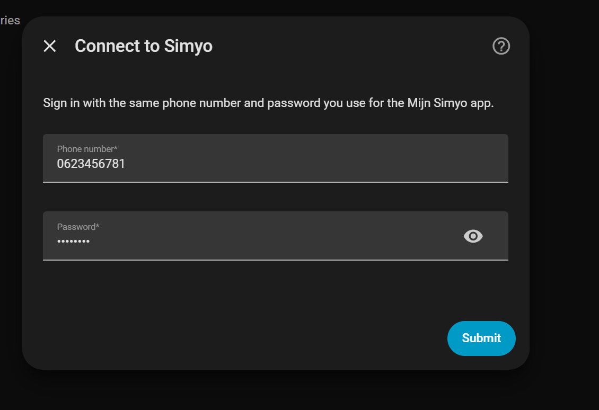
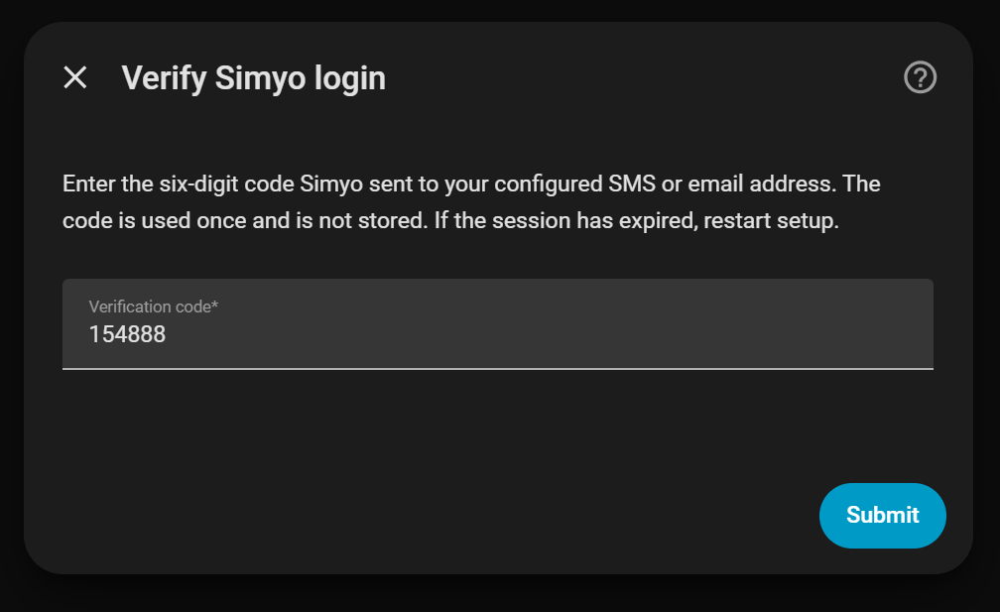
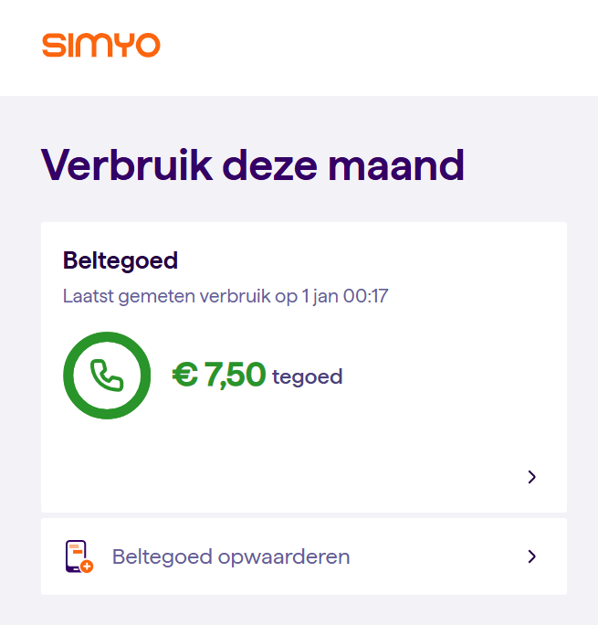
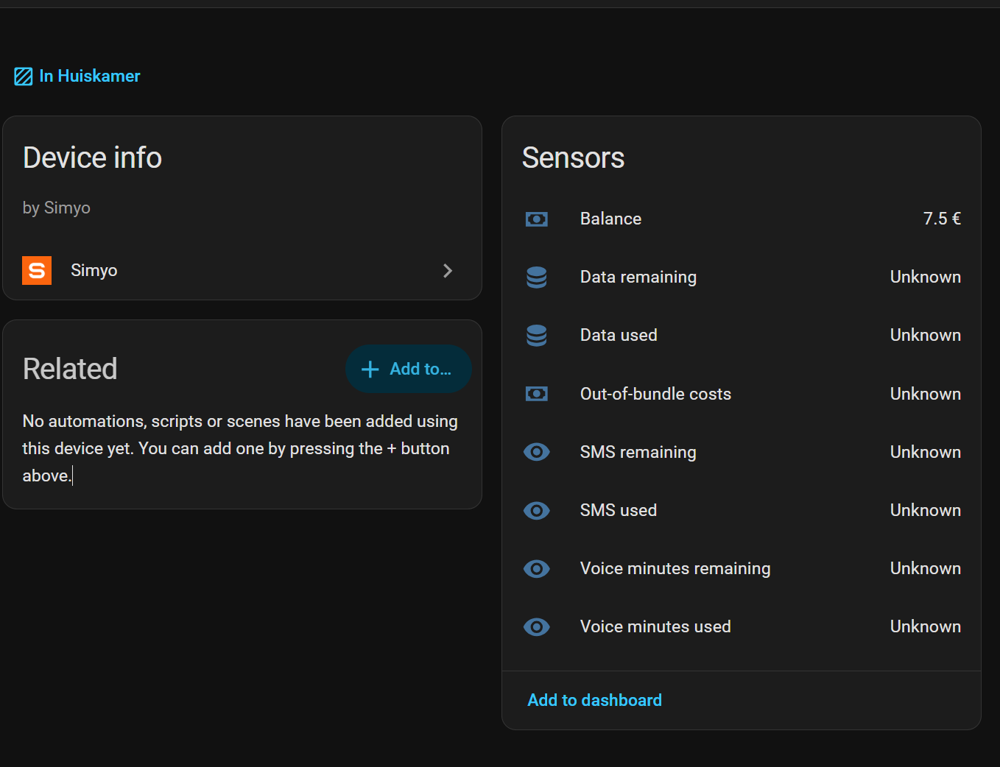

# Simyo-integratie voor Home Assistant

Een aangepaste Home Assistant-integratie die de website-API van
[Mijn Simyo](https://mijn.simyo.nl/) periodiek uitleest en prepaidbeltegoed en
beschikbare verbruiksgegevens als sensoren beschikbaar maakt.

## Schermafbeeldingen

### Inloggen bij Mijn Simyo

Vul je telefoonnummer en Mijn Simyo-wachtwoord in Home Assistant in.



### Tweestapsverificatie

Als je account tweestapsverificatie gebruikt, vul je de code in die Simyo je stuurt.



### Prepaidbeltegoed in Mijn Simyo

Het prepaidoverzicht op de Simyo-website toont het beschikbare beltegoed.



### Sensoren in Home Assistant

De integratie toont het prepaidbeltegoed in Home Assistant. Andere sensoren
kunnen `Unknown` (onbekend) tonen wanneer de gegevens ontbreken of nog niet
correct aan een sensor zijn gekoppeld.



## Aanmelden en tweestapsverificatie

Deze fork implementeert de aanmelding en verificatie met een eenmalige code
(OTP) van de Mijn Simyo-website, zoals onderzocht via de ontwikkelaarstools
van de browser op 30 oktober 2026. Aanmelden, codeverificatie en het ophalen
van gegevens gebruiken dezelfde websitesessie. Websitetokens worden niet
naar de app-API gestuurd.

1. `POST https://mijn.simyo.nl/auth/login` met `phoneNumber` en `password`.
2. Een antwoord met `user.mfaStatus == PENDING_VERIFICATION` opent een apart
   formulier voor de verificatiecode. Het beperkte sessietoken geeft nog
   geen toegang tot de verbruiksgegevens.
3. `POST /api/post?endpoint=securityVerifyOtp` met `rememberMe: true` en
   `token: <zescijferige code>`, met **dezelfde eigen cookieopslag voor de websitesessie**.
4. Het bevestigde token komt uit `result.token`. De client roept
   `POST /auth/update-token` aan met dat token en `rememberMe: true` om de
   websitesessie op de server bij te werken en de aanmelding te onthouden.
5. Gegevens worden opgehaald via `GET /api/get?endpoint=prepaidOverview` en
   `GET /api/get?endpoint=getAggregated`.

Home Assistant bewaart alleen het bevestigde sessietoken en expliciet
toegestane authenticatie- en routeringscookies bij de integratieconfiguratie.
Cookies van een nog onbevestigde verificatie en eenmalige codes worden nooit
opgeslagen. Er wordt geen browsersessie gekopieerd: deze cookies horen bij
de eigen succesvolle aanmelding van de integratie.

De eerste aanmelding en het aanvragen van de code blijven binnen dezelfde
configuratieprocedure, ook bij het opnieuw invoeren van een onjuiste code.
Een verlopen verificatie vereist een nieuwe aanmelding. Verzoeklimieten
worden gemeld zonder automatisch nieuwe codes te versturen. De integratie
vraagt Simyo met `rememberMe: true` om de aanmelding te onthouden.
Tweestapsverificatie blijft ingeschakeld op het account.

Vanaf versie 0.2.3 wordt de onthoudfunctie aangevraagd bij een nieuwe
aanmelding met verificatiecode. Een verlopen sessie wordt hierdoor niet
opnieuw geldig: meld na installatie van de update nog eenmaal aan.
Simyo bepaalt de geldigheidsduur; een sessie van maanden is niet gegarandeerd.

Home Assistant hergebruikt de opgeslagen sessie na een herstart. Als Simyo
de sessie laat verlopen en opnieuw om tweestapsverificatie vraagt, moet je
opnieuw je wachtwoord en een code invoeren. De formulieren zijn beschikbaar
in het Nederlands en Engels. Logboeken bevatten alleen vaste foutcategorieën
en HTTP-statuscodes, nooit antwoordinhoud of authenticatiegegevens.

Het oorspronkelijke hulpmiddel voor rechtstreeks aanmelden bij de app-API
blijft beschikbaar voor diagnose. De integratie combineert die app-API niet
meer met de authenticatie van de website.

## Controle en beperkingen

De bovenstaande verzoeken en antwoorden zijn onderzocht tijdens een
succesvolle aanmelding in de browser. Automatische tests controleren de
client en de configuratiestappen met nagebootste Home Assistant-interfaces,
het afschermen van geheime gegevens, het hergebruik van tokens en het behoud
van HTTP-cookies via een **lokale testserver**. Deze tests vervangen geen
volledige praktijktest in Home Assistant.

De gecorrigeerde aanmelding via de website is ook met een echt account
getest: aanmelden met tweestapsverificatie, het ophalen van beltegoed en
verbruik en het hergebruiken van de bevestigde sessie zijn geslaagd. In
Home Assistant is het prepaidbeltegoed zichtbaar en kwam de koppeling na
een herstart terug zonder nieuwe verificatiecode.

Voer de tests uit met Python 3.12 of hoger:

```sh
python -m pip install aiohttp voluptuous
python -m unittest discover -s tests -v
```

Test deze fork lokaal zonder Home Assistant te installeren:

```sh
python tools/verify_2fa.py
```

Deze praktijktest vraagt lokaal om je inloggegevens en verificatiecode
(beide verborgen), toont alleen of stappen slagen of mislukken en bewaart
geen tokens of antwoorden. De test haalt gegevens op en herstelt de
bevestigde websitesessie in een nieuwe client om hergebruik zonder een
nieuwe verificatiecode te controleren.

Dit is een onofficiële integratie die afhankelijk is van niet-openbare
Simyo-interfaces. De oorspronkelijke sensorimplementatie probeert gegevens
op verwachte veldpaden te vinden en biedt de ruwe beltegoed- en
verbruiksgegevens als entiteitsattributen aan. De koppeling van prepaidvelden
aan sensoren kan nog aanpassing nodig hebben, ook als aanmelden lukt.

## Installatie

1. Kopieer `custom_components/simyo` naar de map `config/custom_components/` van Home Assistant.
2. Herstart Home Assistant.
3. Ga naar **Instellingen → Apparaten & diensten → Integratie toevoegen** en kies **Simyo**.
4. Vul je Simyo-telefoonnummer (bijvoorbeeld `0612345678`) en Mijn Simyo-wachtwoord in.
5. Vul zo nodig de nieuwste zescijferige verificatiecode in het aparte formulier in.

## Sensoren

| Sensor | Gegevenssectie |
| ------ | -------------- |
| Beltegoed | `balance` |
| Dataverbruik / resterende data | `usage` |
| Verbruikte / resterende belminuten | `usage` |
| Verbruikte / resterende sms'jes | `usage` |
| Kosten buiten de bundel | `usage` |

Elke sensor biedt de volledige ruwe gegevenssectie ook aan via het attribuut
`raw`. Dit helpt bij foutonderzoek en bij het maken van templatesensoren
voor velden die nog niet aan een sensor zijn gekoppeld.

## Vernieuwen van gegevens

De integratie haalt elke 5 uur gegevens op. Simyo stuurt wijzigingen niet
rechtstreeks naar de integratie.

## Diagnose van de oude app-aanmelding

`python tools/probe_login.py` onderzoekt de oudere rechtstreekse
app-aanmelding en toont de antwoordstructuur met afgeschermde waarden.
Dit hulpmiddel voert de websiteverificatie niet uit. Gebruik
`tools/verify_2fa.py` om de huidige aanmelding van deze fork te testen.

## Lokale logo's

Het officiële Simyo-pictogram en woordmerk staan in
`custom_components/simyo/brand/`, als PNG-bestanden in normale en hoge
resolutie, inclusief varianten voor het donkere thema. Home Assistant
2026.3 en hoger ondersteunt deze lokale afbeeldingen. De gebruikersinterface
kan ze daardoor tonen zonder afhankelijk te zijn van een externe logodienst.

Afbeeldingsbronnen: [Simyo-pictogram](https://www.simyo.nl/assets/favicon/apple-touch-icon.png)
en [Simyo-woordmerk](https://www.simyo.nl/assets/images/logo/simyo-yorange.svg).
De Simyo-naam en afbeeldingen blijven handelsmerken van hun respectieve
eigenaar. Deze onofficiële integratie is niet verbonden aan Simyo.
